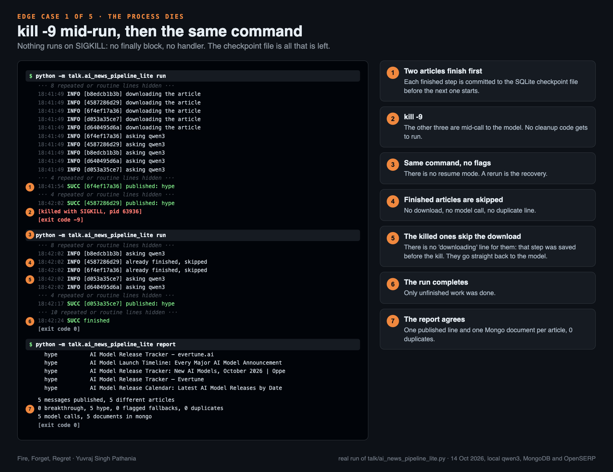
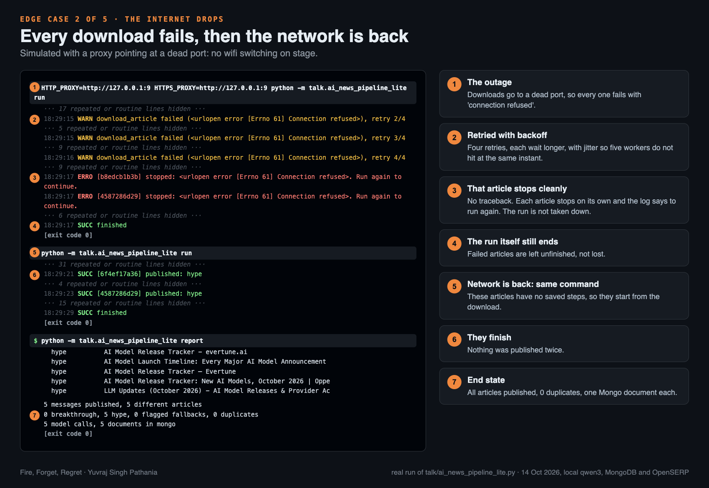
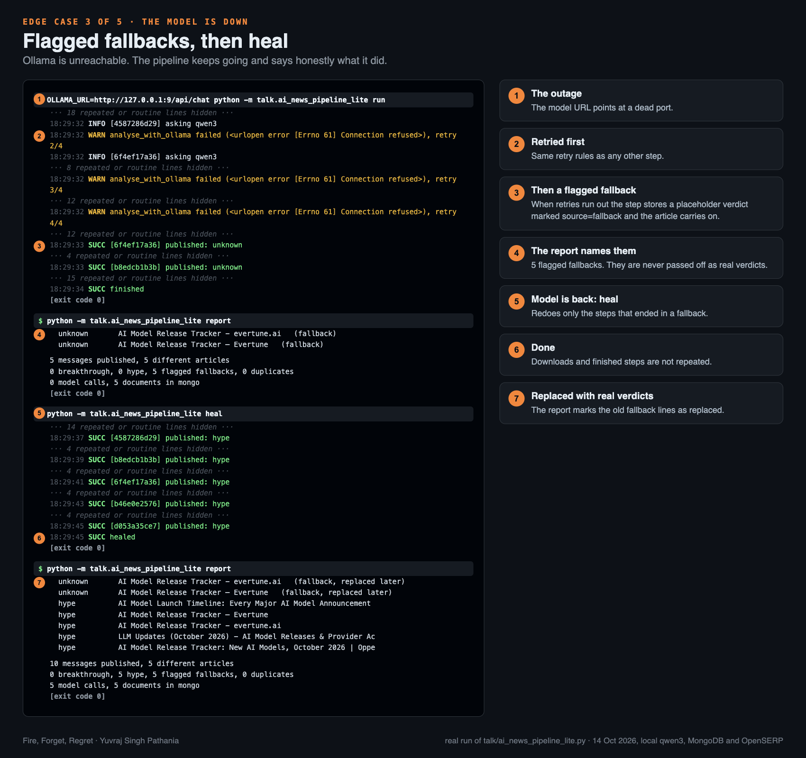
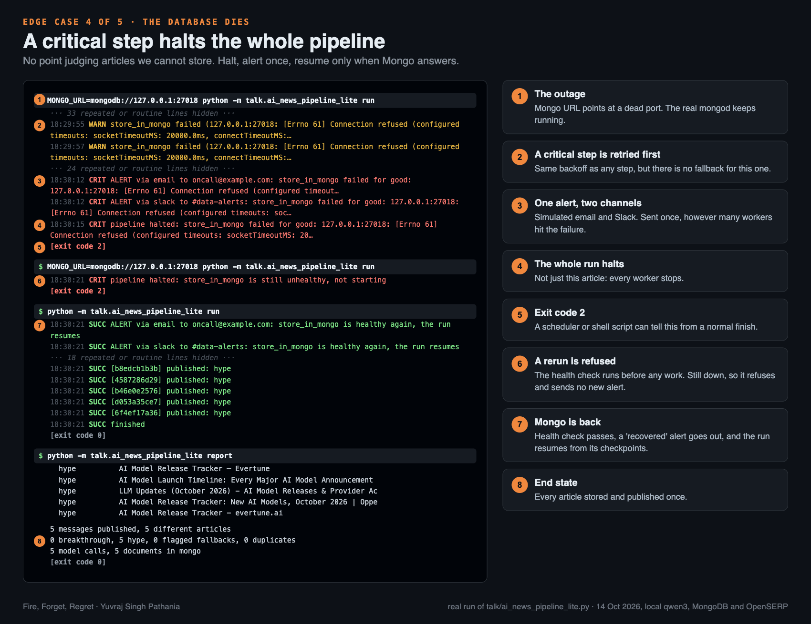
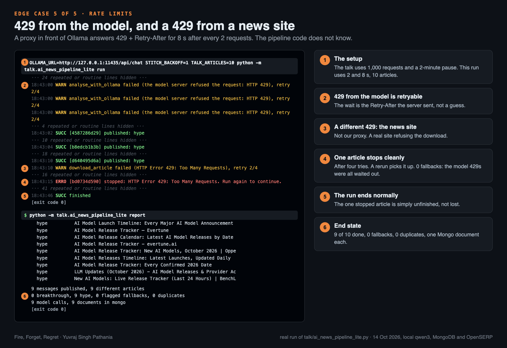

# Fire, Forget, Regret

Companion repository for the PyCon NL 2026 talk. It shows what breaks in a long-running pipeline, and how adding a
decorator makes it durable.

```
talk/ai_news_pipeline.py        the plain pipeline
talk/ai_news_pipeline_lite.py   the same pipeline, made durable with stitch-lite
talk/ollama_cooldown_proxy.py   a rate limit in front of Ollama, for the stress run
stitch-lite/                    the durable core: one standard-library file, 182 code lines
tests/                          unittest for all of the above
screenshots/                    annotated real runs of each failure, with their raw logs
```

## The demo

A pipeline keeps searching for fresh AI news through a local OpenSERP server, downloads each new URL, asks a local
Ollama model (qwen3) whether it is a real breakthrough or just hype, stores the verdict in MongoDB and publishes the
result. Five workers, and it never stops unless `TALK_ARTICLES` caps it.

```bash
pip install -r requirements.txt        # loguru, pymongo, openserp and stitch-lite from this repo
ollama pull qwen3                      # and keep Ollama running
docker run -d -p 27017:27017 mongo:7   # or any MongoDB, see MONGO_URL
docker run -d -p 7001:7000 karust/openserp serve   # search; macOS AirPlay owns port 7000
export OPENSERP_URL=http://127.0.0.1:7001

python -m talk.ai_news_pipeline reset
python -m talk.ai_news_pipeline run     # then kill -9 it, switch wifi off, or stop Ollama
python -m talk.ai_news_pipeline report  # what it published, duplicates, model calls, mongo documents

diff talk/ai_news_pipeline.py talk/ai_news_pipeline_lite.py     # everything durability adds
python -m talk.ai_news_pipeline_lite run       # same failures, now it resumes
python -m talk.ai_news_pipeline_lite heal      # replace fallback results once the model is back
```

To stress it, put a rate limit in front of Ollama: after every 10 requests the proxy answers 429 with a
`Retry-After` for 10 seconds (set `TALK_COOLDOWN_EVERY=1000 TALK_COOLDOWN_SECONDS=120` for the full-size version).
The pipeline scripts know nothing about it.

```bash
python -m talk.ollama_cooldown_proxy
OLLAMA_URL=http://localhost:11435/api/chat python -m talk.ai_news_pipeline_lite run
```

Knobs: `TALK_ARTICLES` (0 = forever), `TALK_PASSES`, `TALK_MAX_AGE_DAYS`, `TALK_WORKERS` (5), `STITCH_BACKOFF`
(1.0), `TALK_ENGINES` (duckduckgo,bing), `OPENSERP_URL`, `OLLAMA_URL`, `OLLAMA_MODEL`, `MONGO_URL`;
for the proxy `TALK_COOLDOWN_EVERY` (10), `TALK_COOLDOWN_SECONDS` (10), `TALK_PROXY_PORT` (11435).

The full stitch library lives in its own repository, [batman004/stitch](https://github.com/batman004/stitch).

## What durability looks like

Five real runs of `ai_news_pipeline_lite.py` against live search, a local qwen3 and a local MongoDB. Each image
numbers the lines that matter; the raw output is in [screenshots/logs/](screenshots/logs/). Every run was started
the same way, and the recovery is always the same command.

**1. The process is killed with `kill -9`.** Two articles had finished and are skipped on the rerun. The three that
were killed mid-call do not download again, because that step was saved. 0 duplicates.



**2. The internet drops.** Every download fails, retries with backoff, and each article stops cleanly. Run again
once the network is back and all five finish. The outage is a proxy pointing at a dead port.



**3. The model is down.** After its retries each article gets a flagged `fallback` verdict and the run carries on.
`heal` later redoes only those steps once the model is back.



**4. The database dies.** Storing in Mongo is a critical step: the whole run halts, one simulated email and Slack
alert go out, and the exit code is 2. A rerun is refused until Mongo answers, then it resumes from its checkpoints.



**5. Rate limits.** The cooldown proxy answers 429 with `Retry-After`, and the pipeline waits exactly that long.
A real news site also returned 429 on one download, and that single article stopped cleanly.



## Tests

```bash
python -m unittest
```

They cover stitch-lite, both demo scripts (kill and resume, internet down, the model refusing, heal, Mongo down) and
the Ollama cooldown proxy, with a fake network. The demo tests are skipped if `loguru`, `pymongo` or `openserp` is not
installed. MIT licence.
